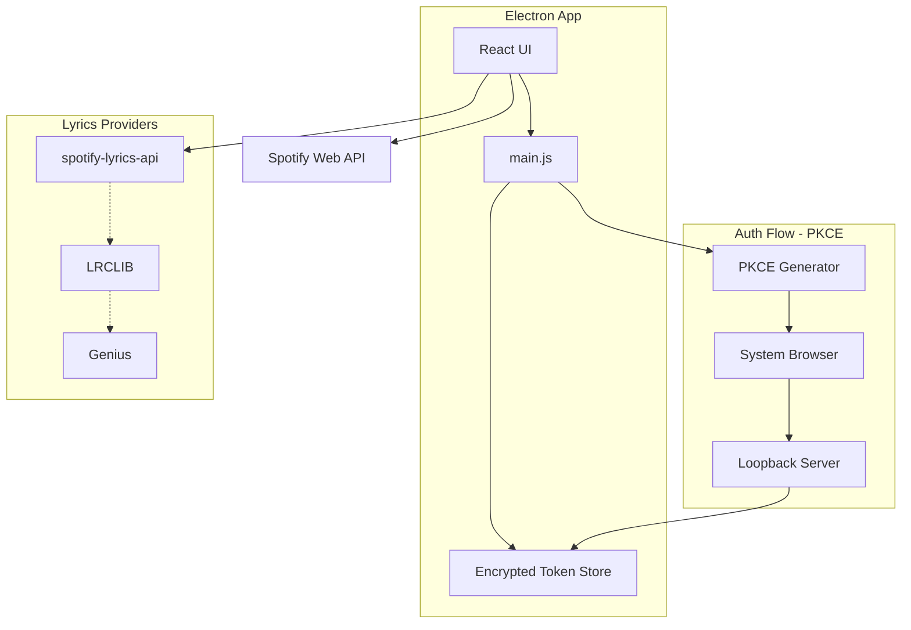
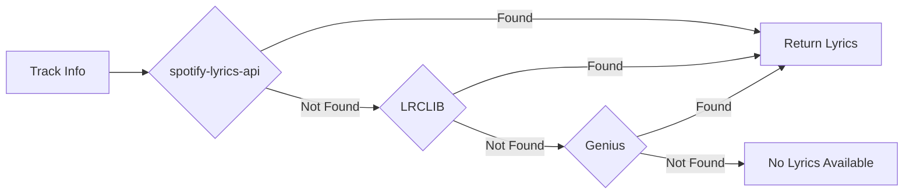

# SOTA Spotiffy Dock Implementation

## Architecture Overview




## Key Changes from Current Implementation


| Current                         | SOTA Implementation                                |
| ------------------------------- | -------------------------------------------------- |
| Backend server required         | Direct API calls from Electron (no backend needed) |
| Client secret exposed           | PKCE flow (no secret required)                     |
| In-memory token storage         | Encrypted file-based storage with auto-refresh     |
| Single lyrics provider (LRCLIB) | Multi-provider fallback chain                      |
| Polling every 1s                | Smart polling with exponential backoff             |
| No error recovery               | Retry logic with graceful degradation              |


---

## 1. Authentication - PKCE OAuth Flow

Spotify now **requires PKCE** for desktop apps (April 2025). This eliminates the need for a backend server.

**Implementation:**

- Generate `code_verifier` (random 43-128 char string) and `code_challenge` (SHA256 hash)
- Open Spotify auth URL in **system browser** (not Electron window)
- Listen on `http://127.0.0.1:8888/callback` for the redirect
- Exchange code for tokens directly (no client secret needed)

**Files to modify:**

- Create new `src/services/SpotifyAuth.js` - PKCE auth handler
- Create new `src/utils/tokenStore.js` - Encrypted token persistence
- Remove `server/` directory entirely (not needed)

**Scopes needed:**

```javascript
const SCOPES = [
  'user-read-playback-state',
  'user-modify-playback-state', 
  'user-read-currently-playing',
  'user-read-private'  // For user profile
];
```

---

## 2. Token Storage - Encrypted Persistence

Store tokens securely using Electron's `safeStorage` API.

**Location:** `%APPDATA%/spotiffy-dock/tokens.json` (encrypted)

**Structure:**

```javascript
{
  access_token: "encrypted...",
  refresh_token: "encrypted...",
  expires_at: 1234567890,
  user_id: "spotify_user_id"
}
```

**Auto-refresh:** Check token validity before each API call, refresh if expires within 5 minutes.

---

## 3. Spotify API - Direct Calls

Remove the backend server entirely. Call Spotify API directly from Electron main process.

**File:** `src/services/SpotifyAPI.js`

**Endpoints used:**

- `GET /me/player` - Current playback state
- `GET /me/player/queue` - Queue
- `PUT /me/player/play` - Play
- `PUT /me/player/pause` - Pause
- `POST /me/player/next` - Skip next
- `POST /me/player/previous` - Skip previous
- `PUT /me/player/volume` - Set volume
- `PUT /me/player/seek` - Seek position
- `PUT /me/player/shuffle` - Toggle shuffle
- `PUT /me/player/repeat` - Set repeat mode

---

## 4. Lyrics System - Multi-Provider Fallback




**Provider 1: spotify-lyrics-api (Unofficial Spotify/Musixmatch)**

- Endpoint: `https://spotify-lyrics-api-pi.vercel.app/` 
- Best coverage for synced lyrics including regional songs
- Requires track ID from Spotify

**Provider 2: LRCLIB (Already implemented)**

- Endpoint: `https://lrclib.net/api/search`
- Good coverage for English songs
- Free, no auth needed

**Provider 3: Genius (Fallback for plain lyrics)**

- Requires API key (free tier)
- Returns plain text lyrics (no sync)
- Good coverage for all languages

**Caching:** Cache lyrics locally by track ID to avoid repeated API calls.

---

## 5. Improved UI/UX

**Login Screen:**

- Show user profile after login (name, avatar)
- "Logout" button to clear tokens

**Now Playing Panel:**

- Working shuffle/repeat buttons with state indicators
- Device selector dropdown
- Like/unlike button

**Lyrics Panel:**

- Provider indicator (showing which source)
- Manual sync offset slider (+/- 5 seconds)
- "No lyrics" message with search link

**Queue Panel:**

- Show more items (scrollable, 5-7 tracks)
- Show queue source (playlist name, album, etc.)

---

## 6. File Structure (Final)

```
spotiffy-dock/
├── main.js                    # Electron main (auth, IPC)
├── preload.js                 # Secure bridge
├── src/
│   ├── App.js                 # Main React component
│   ├── components/
│   │   ├── LoginScreen.js     # NEW: Login UI
│   │   ├── NowPlaying.js      # Updated controls
│   │   ├── LyricsPanel.js     # Updated with offset
│   │   └── QueuePanel.js      # Updated scrollable
│   ├── services/
│   │   ├── SpotifyAuth.js     # NEW: PKCE auth
│   │   ├── SpotifyAPI.js      # NEW: Direct API calls
│   │   └── LyricsService.js   # NEW: Multi-provider
│   ├── utils/
│   │   ├── tokenStore.js      # NEW: Encrypted storage
│   │   └── config.js          # App configuration
│   └── styles.css
├── package.json
└── config.js                  # Spotify Client ID only
```

---

## 7. Configuration Required

User only needs to provide their **Spotify Client ID** (no secret needed):

```javascript
// config.js
module.exports = {
  SPOTIFY_CLIENT_ID: 'your_client_id_here',
  REDIRECT_URI: 'http://127.0.0.1:8888/callback'
};
```

**Spotify Dashboard setup:**

1. Create app at developer.spotify.com
2. Add redirect URI: `http://127.0.0.1:8888/callback`
3. Copy Client ID to config.js

---

## 8. Error Handling Strategy


| Error            | Recovery                                   |
| ---------------- | ------------------------------------------ |
| Token expired    | Auto-refresh using refresh_token           |
| Refresh failed   | Prompt re-login                            |
| No active device | Show "Open Spotify" message                |
| Rate limited     | Exponential backoff (2s, 4s, 8s...)        |
| Network error    | Retry 3 times, then show offline indicator |
| Lyrics not found | Try next provider, show "No lyrics"        |


---

## Summary of Benefits

1. **No backend server needed** - Simpler deployment, works offline (except API calls)
2. **Secure PKCE auth** - No client secret exposed, follows Spotify's 2025 requirements
3. **Persistent login** - Tokens survive app restart
4. **Better lyrics coverage** - Multiple providers including unofficial Spotify lyrics
5. **Reliable controls** - Direct API calls with proper error handling
6. **Multi-user support** - Each user gets their own token storage

